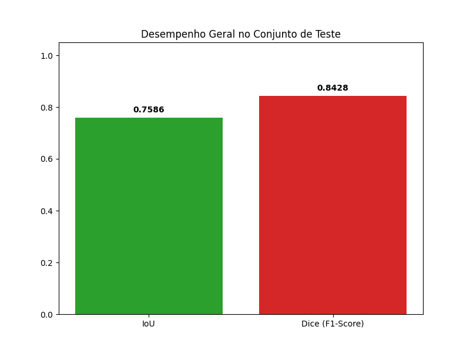
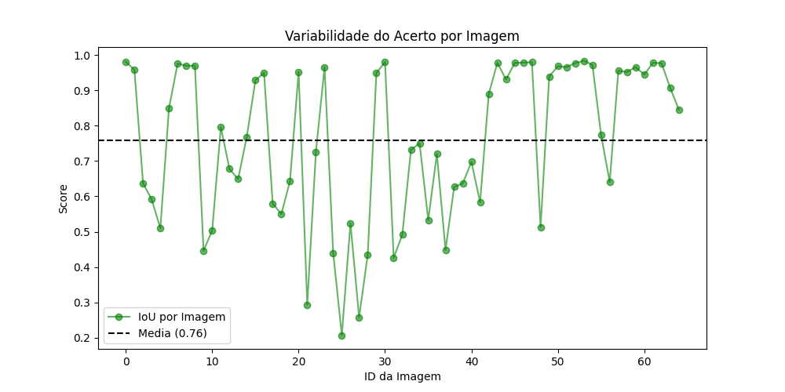

# DeepLabV3_Soja — Segmentação de folhas de soja com DeepLabV3+

Modelo de **segmentação binária** (folha × fundo) de imagens de folhas de soja usando a arquitetura **DeepLabV3+** com encoder **MobileNetV2** pré-treinado na ImageNet, implementada com a biblioteca [segmentation_models_pytorch](https://github.com/qubvel/segmentation_models.pytorch).

## Resultados

Avaliação no conjunto de teste (65 imagens), com o checkpoint `best_deeplab_soja.pth`:

| Métrica | Valor |
|---|---|
| IoU médio | **0,7586** |
| Dice (F1) médio | **0,8428** |

Na validação, o melhor IoU foi de aproximadamente 0,733 com threshold 0,40 (50 épocas registradas no Weights & Biases).




## Modelo

| Item | Configuração |
|---|---|
| Arquitetura | DeepLabV3+ (`smp.DeepLabV3Plus`) |
| Encoder (backbone) | `mobilenet_v2`, pesos ImageNet |
| Saída | 1 canal (logits), sigmoide na inferência |
| Função de perda | `0,5 × BCEWithLogitsLoss + 0,5 × DiceLoss` |
| Otimizador | AdamW (`lr=1e-4`, `weight_decay=1e-4`) |
| Scheduler | ReduceLROnPlateau (modo `max`, fator 0,5, paciência 5) |
| Resolução de entrada | 384 × 384 |
| Batch size | 8 |
| Precisão mista | AMP automático quando há GPU |
| Seed | 42 |

**Busca de threshold:** a cada época a validação testa thresholds de 0,30 a 0,70 e guarda o que dá maior IoU. Esse valor é salvo no checkpoint e reutilizado automaticamente em `test.py` e `predict.py`.

**Aumento de dados (Albumentations):** flip horizontal e vertical, rotação de 90°, brilho/contraste e matiz/saturação, além de normalização ImageNet.

## Dados

- `data/images/` e `data/masks/`: 1106 imagens e máscaras binárias (`.png` com o mesmo nome da imagem).
- Divisão treino/validação 80/20 (884 / 222), fixada em [`splits/train_val_split_seed42.json`](splits/train_val_split_seed42.json) para ser reproduzível.
- `data/test/images/` e `data/test/masks/`: 65 imagens de teste.

A pasta `data/` não está no repositório por causa do tamanho.

## Estrutura

```
DeepLabV3_Soja/
├── main.py               # Treinamento (com log no Weights & Biases)
├── test.py               # Avaliação no conjunto de teste + gráficos
├── predict.py            # Inferência e visualização em uma imagem
├── src/
│   ├── dataset.py        # SojaDataset (imagem + máscara)
│   ├── losses.py         # BCEDiceLoss
│   ├── model_factory.py  # Criação do DeepLabV3+
│   ├── train.py          # Loops de treino e validação
│   └── utils.py          # Cálculo de IoU
├── splits/               # Divisão treino/validação
├── resultados_finais/    # Gráficos de teste
├── data/                 # Dataset (não versionado)
└── weights/              # Checkpoints (não versionado)
```

## Requisitos

```bash
pip install torch torchvision segmentation-models-pytorch albumentations opencv-python numpy matplotlib tqdm wandb
```

## Uso

**Treinar** (os hiperparâmetros podem ser trocados por variáveis de ambiente):

```bash
EPOCHS=100 BATCH_SIZE=8 LR=1e-4 IMAGE_SIZE=384 BACKBONE=mobilenet_v2 python main.py
```

O melhor modelo é salvo em `weights/best_deeplab_soja.pth`, junto com o melhor IoU, o threshold, a resolução e o backbone.

**Avaliar no teste:**

```bash
python test.py
```

Os gráficos são gerados em `resultados_finais/`.

**Inferência em uma imagem** (ajuste `IMAGE_PATH` em `predict.py`):

```bash
python predict.py
```

Mostra a imagem original, o mapa de probabilidades e a máscara final sobreposta.

## Uso em outros projetos

Este modelo é usado como detector inicial no pipeline híbrido [projeto_soja_sam-DeepLab](https://github.com/pedroh-1/projeto_soja_sam-DeepLab), em que a máscara do DeepLab gera a caixa usada como prompt do SAM.
